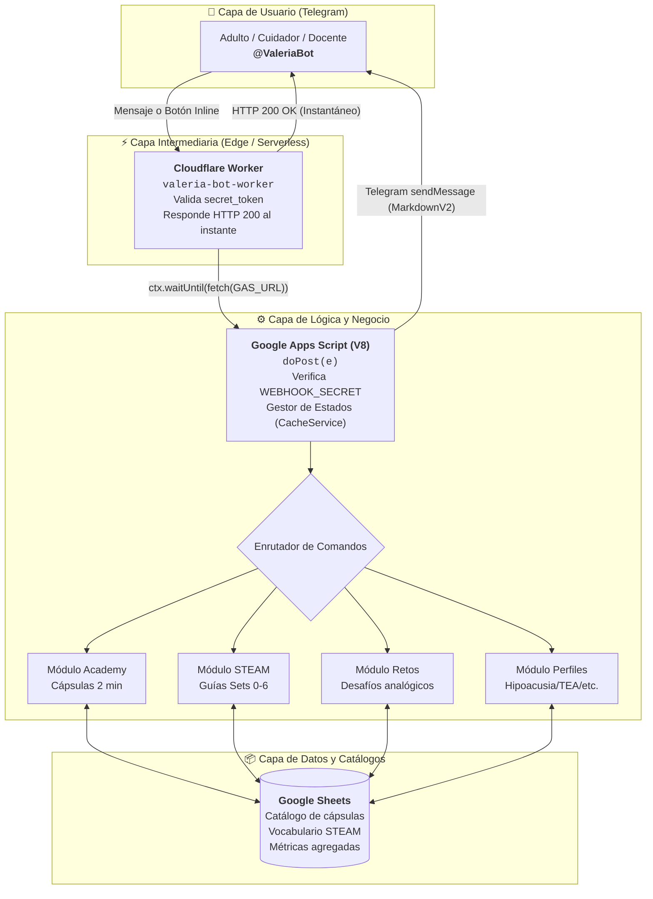
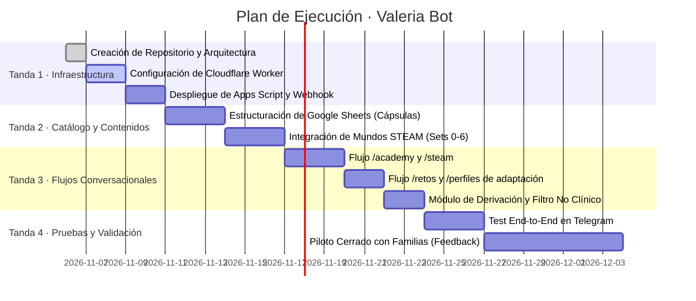

<div align="center">

# 🐈‍⬛ Valeria Bot (@ValeriaBot)
### Asistente y Acompañante en Telegram para Familias y Educadores de Valeria+

**Acompañamiento conversacional, cápsulas de la Academy y retos STEAM analógicos para el hogar y el aula.**  
Extensión en Telegram de **Valeria+**, diseñada para guiar al adulto en la estimulación del lenguaje y la comunicación infantil, mediada a través de los mundos manipulativos de **Construye con Lúa**.

<br>

<!-- Badges de Estado y Plataforma -->


</div>

<div align="center">
  <a href="#-propósito-y-frontera-del-servicio"><b>Propósito</b></a> ·
  <a href="#-arquitectura-técnica-del-sistema"><b>Arquitectura</b></a> ·
  <a href="#-stack-tecnológico"><b>Stack</b></a> ·
  <a href="#-flujos-conversacionales-del-bot"><b>Flujos del Bot</b></a> ·
  <a href="#-integración-con-los-mundos-steam-y-la-academy"><b>Mundos STEAM</b></a> ·
  <a href="#-privacidad-y-zero-phi-estructural"><b>Privacidad</b></a> ·
  <a href="#-plan-de-trabajo-y-hoja-de-ruta"><b>Plan de Trabajo</b></a> ·
  <a href="#-despliegue-y-puesta-en-marcha"><b>Puesta en Marcha</b></a>
</div>

---

## 📑 Índice de Contenidos

1. [Propósito y Frontera del Servicio](#-propósito-y-frontera-del-servicio)
   - [¿Qué es Valeria Bot?](#qué-es-valeria-bot)
   - [Qué NO es (Muro de Seguridad y Frontera Regulatoria)](#qué-no-es-muro-de-seguridad-y-frontera-regulatoria)
   - [Las 3 Reglas de Oro del Ecosistema](#las-3-reglas-de-oro-del-ecosistema)
2. [Arquitectura Técnica del Sistema](#-arquitectura-técnica-del-sistema)
   - [Diagrama de Flujo Integral (Patrón de 3 Capas)](#diagrama-de-flujo-integral-patrón-de-3-capas)
   - [Por qué existe el Worker de Cloudflare (Solución HTTP 302)](#por-qué-existe-el-worker-de-cloudflare-solución-http-302)
   - [Seguridad de Secretos y Handshake Webhook](#seguridad-de-secretos-y-handshake-webhook)
3. [Stack Tecnológico y Costes](#-stack-tecnológico-y-costes)
4. [Flujos Conversacionales del Bot](#-flujos-conversacionales-del-bot)
   - [Menú Principal y Comandos Canónicos](#menú-principal-y-comandos-canónicos)
   - [Flujo 1: Formación Rápida · Academy Express](#flujo-1-formación-rápida--academy-express)
   - [Flujo 2: Guía de Mediación de Mundos STEAM](#flujo-2-guía-de-mediación-de-mundos-steam)
   - [Flujo 3: Reto del Día / Desafío Analógico Sin Pantallas](#flujo-3-reto-del-día--desafío-analógico-sin-pantallas)
   - [Flujo 4: Perfiles de Adaptación e Inclusión](#flujo-4-perfiles-de-adaptación-e-inclusión)
   - [Flujo 5: Dudas y Desescalada Pedagógica](#flujo-5-dudas-y-desescalada-pedagógica)
5. [Integración con los Mundos STEAM y la Academy](#-integración-con-los-mundos-steam-y-la-academy)
   - [Mapeo de Sets de Construye con Lúa en Telegram](#mapeo-de-sets-de-construye-con-lúa-en-telegram)
   - [Estructura Pedagógica de las Respuestas](#estructura-pedagógica-de-las-respuestas)
6. [Privacidad y Zero-PHI Estructural](#-privacidad-y-zero-phi-estructural)
7. [Plan de Trabajo y Hoja de Ruta (Metodología Alerta Dengue)](#-plan-de-trabajo-y-hoja-de-ruta)
   - [Convención de Estado](#convención-de-estado)
   - [Objetivos del Proyecto](#objetivos-del-proyecto)
   - [Desglose de Fases y Tandas de Ejecución](#desglose-de-fases-y-tandas-de-ejecución)
8. [Despliegue y Puesta en Marcha](#-despliegue-y-puesta-en-marcha)
   - [Variables de Entorno y Propiedades del Script](#variables-de-entorno-y-propiedades-del-script)
   - [Configuración del Worker de Cloudflare](#configuración-del-worker-de-cloudflare)
   - [Registro del Webhook en Telegram](#registro-del-webhook-en-telegram)
9. [Gobernanza, Autoría y Contacto Legal](#-gobernanza-autoría-y-contacto-legal)

---

## 🎯 Propósito y Frontera del Servicio

### ¿Qué es Valeria Bot?
**Valeria Bot** es un canal conversacional en Telegram concebido como **herramienta de apoyo directo para adultos (familias, educadores infantiles y cuidadores)** que utilizan la aplicación **Valeria+** en el hogar o en el aula.

Su misión es llevar al bolsillo del adulto:
1. **Cápsulas pedagógicas de la Academy en 2 minutos:** cómo acompañar al niño, qué observar en cada actividad y cómo enriquecer su lenguaje natural.
2. **Guías de mediación para los 6 mundos de Construye con Lúa:** qué vocabulario espacial y de proceso ofrecer después de que el niño experimenta con los bloques físicos.
3. **Retos analógicos diarios:** ideas lúdicas de estimulación sin pantallas ni tecnología intrusiva.
4. **Pautas de inclusión por perfil:** ajustes para familias de niñas y niños con hipoacusia, implante coclear, TEA, dislexia o dislalias.

---

### Qué NO es (Muro de Seguridad y Frontera Regulatoria)
> [!IMPORTANT]
> **Valeria Bot es un recurso exclusivamente educativo y pedagógico. NO es un dispositivo médico (No SaMD) ni un canal de consulta clínica.**

* **No diagnostica ni evalúa:** jamás calcula puntuaciones clínicas, percentiles ni emite juicios diagnósticos sobre el desarrollo o el habla.
* **No realiza triaje médico:** ante preguntas sobre patologías, regresiones bruscas o inquietudes clínicas, desescala de inmediato y deriva a la pediatra, logopeda u otorrino de referencia.
* **No almacena datos de menores:** no solicita ni almacena nombres, fechas exactas de nacimiento, diagnósticos ni audios de niñas o niños.
* **No sustituye la interacción humana ni la terapia:** refuerza el papel del adulto como mediador del aprendizaje.

---

### Las 3 Reglas de Oro del Ecosistema

1. **La criatura NO toca el bot ni la pantalla:** El canal de Telegram es exclusivamente para la persona adulta (madre, padre, docente o terapeuta).
2. **El fenómeno manda y el lenguaje lo nombra:** En las actividades STEAM, el niño primero manipula y descubre con las manos; el adulto observa y luego nombra lo ocurrido. El bot enseña al adulto cómo hacer *recast* y modelado lingüístico.
3. **Cero datos personales (Zero-PHI estructural):** Tratamiento anónimo bajo la Ley 172-13 y el RGPD.

---

## 🏗️ Arquitectura Técnica del Sistema

Valeria Bot hereda la **arquitectura robusta y probada de 3 capas** desarrollada e implementada con éxito en el sistema de vigilancia participativa **Alerta Dengue RD** (La Vega, República Dominicana):

### Diagrama de Flujo Integral (Patrón de 3 Capas)



---

### Por qué existe el Worker de Cloudflare (Solución HTTP 302)

Al igual que en **Alerta Dengue RD**, las aplicaciones web de Google Apps Script responden a las peticiones POST de los webhooks con una **redirección HTTP 302 Found**.

La API de Telegram interpreta este código 302 como un error en la entrega del webhook:
1. Pone en reintento el mensaje.
2. Bloquea los mensajes subsiguientes del usuario (`pending_update_count > 0`).
3. El bot parece congelado tras responder a la primera interacción.

**La Solución Canónica:**
Un Worker de Cloudflare ultra-ligero que actúa como terminador de webhook:
- Valida la cabecera `X-Telegram-Bot-Api-Secret-Token` frente al secreto del worker.
- Responde de inmediato con `HTTP 200 OK` a Telegram (evitando reintentos y timeouts).
- Mediante `context.waitUntil(fetch(env.GAS_URL, ...))`, traslada la carga completa al backend en segundo plano.

---

### Seguridad de Secretos y Handshake Webhook

| Nivel de Enlace | Mecanismo de Seguridad | Cabecera / Parámetro |
|---|---|---|
| **Telegram ➔ Worker** | Token secreto configurado en `setWebhook` | `X-Telegram-Bot-Api-Secret-Token: WORKER_SECRET` |
| **Worker ➔ Apps Script** | Parámetro de autenticación en la URL `/exec` | `?s=WEBHOOK_SECRET` |
| **Deduplicación** | Caché temporal de IDs procesados (6 horas) | `CacheService.getScriptCache()` con clave `up_<update_id>` |
| **Persistencia de Sesión**| Máquina de estados conversacionales (1 hora) | `st_<chatId>` con expiración automática |

---

## 🛠️ Stack Tecnológico y Costes

| Capa | Tecnología | Función | Coste Mensual |
|---|---|---|---|
| **Canal de Usuario** | Telegram Bot API (v7.0+) | Interfaz conversacional con menús y teclados inline | $0.00 (Gratuito) |
| **Proxy de Webhook** | Cloudflare Workers (`workers.dev`) | Absorber 302 de Google y responder 200 inmediato | $0.00 (Plan Free: 100k req/día) |
| **Motor de Backend** | Google Apps Script (Runtime V8) | Lógica de diálogo, ruteo y ensamblado pedagógico | $0.00 (Gratuito en cuenta Google) |
| **Base de Conocimiento** | Google Sheets | Tablas desacopladas de cápsulas, vocabulario e hitos | $0.00 (Gratuito en Google Drive) |
| **Repositorio y CI** | GitHub / GitHub Actions | Control de versiones, gates locales y documentación | $0.00 (Repositorio Público) |
| **Coste Total Operativo** | — | **Ecosistema 100% gratuito y sostenible** | **0.00 €/mes** |

---

## 💬 Flujos Conversacionales del Bot

### Menú Principal y Comandos Canónicos

```
/start      - Bienvenida, declaración de propósito no médico y menú principal.
/academy    - Cápsulas de formación para el adulto (2 minutos).
/steam      - Guía práctica para los 6 mundos de Construye con Lúa.
/retos      - Desafío analógico diario sin pantallas para practicar en casa.
/perfiles   - Consejos adaptados (Hipoacusia/Implante Coclear, TEA, Dislexia, Dislalia).
/dudas      - Respuestas a preguntas habituales y pautas de derivación profesional.
/ayuda      - Información del proyecto, privacidad y contacto legal.
```

---

### Flujo 1: Formación Rápida · Academy Express
Permite al cuidador recibir píldoras condensadas de formación antes de iniciar una sesión en casa:
1. El usuario selecciona `/academy`.
2. El bot despliega un teclado inline con los ejes temáticos:
   - 🗣️ *El Arte del Recast* (cómo corregir expandiendo, sin decir "no").
   - ⏳ *El Valor del Silencio* (tiempos de espera y procesamiento).
   - 👁️ *Atención Conjunta* (mirar lo que el niño mira antes de hablar).
   - 🧱 *Nombrar el Fenómeno* (dejar que las manos actúen primero).
3. El bot envía la micro-cápsula (menos de 200 palabras) con un ejemplo real y una consigna para practicar hoy.

---

### Flujo 2: Guía de Mediación de Mundos STEAM
Asiste a la familia cuando van a manipular los sets físicos de **Construye con Lúa**:
1. Selección del Set (Set 1 al Set 6).
2. El bot responde con la tarjeta estructurada:
   - **El fenómeno (manda):** Qué experimento provoca el niño (gravedad, palanca, vibración, flujo de aire).
   - **Qué observar:** Dónde debe fijarse el adulto antes de intervenir.
   - **Vocabulario espacial y de proceso:** 4 palabras clave sugeridas (ej. *inclinado, veloz, contrapeso, vibración*).
   - **Pista de Recast:** Modelo lingüístico exacto para verbalizar el resultado.

---

### Flujo 3: Reto del Día / Desafío Analógico Sin Pantallas
Inspirado en la filosofía vivencial de cero pantallas para la criatura:
- Propuesta de actividad con materiales cotidianos o bloques de madera/duplo.
- Duración sugerida: 10 a 15 minutos de interacción compartida.
- Registro opcional de "Reto completado" que premia al adulto (reconocimiento formativo).

---

### Flujo 4: Perfiles de Adaptación e Inclusión
Ajusta la orientación según la condición de la niña o el niño, manteniendo el marco educativo:
* **Hipoacusia e Implante Coclear:** Pautas de reducción de ruido ambiental, lectura labial, apoyo visual y metrónomo visual.
* **TEA (Espectro Autista):** Anticipación de rutinas, apoyo de Comunicación Aumentativa y Alternativa (CAA), exploración táctil desensibilizada.
* **Dislexia:** Segmentación fonológica rítmica, rimas analógicas, juegos de discriminación auditiva.
* **Dislalias:** Pares mínimos fonológicos y modelado sin frustración.

---

### Flujo 5: Dudas y Desescalada Pedagógica
Respuestas rigurosas a inquietudes habituales:
- "¿Mi hijo de 2 años no dice palabras, qué hago?"
- "¿Es normal que confunda la /r/ con la /d/?"
- **Protocolo de Derivación Automática:** Si el texto del usuario incluye palabras de alarma clínica (regresión, pérdida auditiva súbita, ausencia total de contacto ocular), el bot emite una recomendación cálida pero categórica para acudir a los profesionales sanitarios y de atención temprana.

---

## 🧱 Integración con los Mundos STEAM y la Academy

El bot mapea exactamente los 6 mundos del ecosistema **Construye con Lúa** y **Valeria+**:

| Set | Nombre del Mundo | Fenómeno Físico | Vocabulario Clave que Sugiere el Bot | Pauta de Mediación al Adulto |
|---|---|---|---|---|
| **Set 0** | Kit Lúa | Ensamblaje y esquema corporal | *Cabeza, cuerpo, base, encaje* | El niño monta a Lúa; el adulto describe las posiciones espaciales. |
| **Set 1** | El Camino de Lúa | Algoritmos tangibles y trayectorias | *Primero, después, recto, curva* | Diseñar un camino en 4 baldosas antes de desplazar a Lúa. |
| **Set 2** | Estación de Sonido y Eco | Vibración acústica | *Grave, agudo, resonancia, eco* | Percutir distintas maderas y sentir la vibración antes de nombrarla. |
| **Set 3** | Rampas y Gravedad | Gravedad, pendiente y fricción | *Empinado, suave, acelerar, frenar* | Esperar la cuenta regresiva antes de soltar la esfera. |
| **Set 4** | Máquina de Soplo y Viento | Flujo aerodinámico y presión | *Soplo, brisa, impulso, giro* | Juego lúdico de rotación de aspas, sin finalidad terapéutica. |
| **Set 5** | Puente de Equilibrio | Palanca y centro de masa | *Equilibrio, contrapeso, pesado, liviano*| Desafío de colocar pesos en los extremos sin que caiga. |
| **Set 6** | Jardín de la Sombra y Semilla | Luz, sombra y desarrollo cíclico | *Sombra, claro, crecer, secuencia* | Explorar con una linterna cómo cambia el tamaño de la sombra. |

---

## 🔒 Privacidad y Zero-PHI Estructural

Siguiendo las directivas de seguridad del ecosistema y la normativa vigente (Ley 172-13 en RD y RGPD en Europa):

1. **Sin Identificadores Personales:** No se almacena el nombre, apellido, teléfono ni alias del usuario de Telegram.
2. **Cero Datos de Menores:** El bot no solicita datos sobre niños ni permite crear perfiles clínicos individuales.
3. **Hash Criptográfico con Sal (`HASH_SALT`):** El `chat_id` de Telegram se hashea antes de cualquier registro estadístico para asegurar anonimato absoluto.
4. **Métricas Agregadas:** Solo se registran métricas de uso global (ej. cápsula más leída, set STEAM más consultado) con supresión de frecuencias bajas ($k < 5$).

---

## 📅 Plan de Trabajo y Hoja de Ruta

Copiando la estructura de planificación metodológica de **Alerta Dengue RD**:

### Convención de Estado
- **[HECHO]**: Componente verificado, probado en producción y funcional.
- **[PROPUESTA]**: Especificación técnica redactada y lista para implementación.
- **[HIPÓTESIS]**: Supuesto pedagógico a validar durante el piloto de uso con familias.
- **[POR VERIFICAR]**: Parámetro o integración técnica pendiente de confirmación empírica.

### Objetivos del Proyecto
* **Objetivo General:** Diseñar, desplegar y evaluar un bot en Telegram que ofrezca formación continua y acompañamiento a familias y cuidadores sobre el desarrollo del lenguaje y la comunicación infantil a través de actividades STEAM analógicas.
* **Objetivos Específicos:**
  * **OE1:** Desplegar la infraestructura serverless de 3 capas (Telegram + Cloudflare Worker + Google Apps Script) con latencia < 300 ms y $0 coste.
  * **OE2:** Digitalizar en hojas desacopladas las cápsulas formativas de la Academy de Valeria+ y el catálogo de vocabulario de los 6 mundos STEAM.
  * **OE3:** Diseñar los árboles de navegación interactivos mediante menús y botones inline en Telegram.
  * **OE4:** Integrar el protocolo de desescalada y derivación médica responsable (Muro de Seguridad Zero-PHI).
  * **OE5:** Evaluar la adherencia y satisfacción de un grupo piloto de 30 familias en el hogar.

---

### Desglose de Fases y Tandas de Ejecución



#### Tanda 1: Infraestructura y Enlace Seguro
- Creación de `@ValeriaBot` en BotFather (Telegram).
- Programación del Worker en `cloudflare/worker.js` con soporte para `ctx.waitUntil`.
- Programación de `src/Code.gs` en Google Apps Script con gestión de `update_id` y `WEBHOOK_SECRET`.
- Configuración del webhook con `WORKER_SECRET`.

#### Tanda 2: Base de Conocimiento y Datos Desacoplados
- Hoja `capsulas`: Identificador, tema, título, texto (MarkdownV2), sugerencia práctica.
- Hoja `steam_mundos`: Set ID, nombre, fenómeno, lista de palabras espaciales, consigna de recast.
- Hoja `perfiles`: Recomendaciones específicas para Hipoacusia, TEA, Dislexia, Dislalias.
- Hoja `metricas`: Registro agregado anónimo de consultas.

#### Tanda 3: Motor Conversacional y Menús
- Enrutamiento de comandos y callbacks (`InlineKeyboardMarkup`).
- Generación de respuestas paginadas para no saturar la pantalla.
- Implementación de mensajes de bienvenida con aviso legal y regulatorio prominente.

#### Tanda 4: Validación, Auditoría y Muro de Seguridad
- Verificación de ausencia total de datos de menores.
- Auditoría de textos pedagógicos contrastados con la evidencia de Valeria+.
- Prueba de carga y simulación de fallos de red.

#### Tanda 5: Documentación y Despliegue Público
- Publicación de manuales de uso para familias en PDF/Web.
- Integración del enlace del bot dentro de la app móvil Valeria+.

---

## 🚀 Despliegue y Puesta en Marcha

### Variables de Entorno y Propiedades del Script

En el panel de **Propiedades del Script** de Google Apps Script:

| Propiedad | Descripción | Ejemplo |
|---|---|---|
| `TELEGRAM_TOKEN` | Token de autenticación del bot provisto por BotFather | `123456789:ABCdefGHI...` |
| `WEBHOOK_SECRET` | Token secreto en la query string de Apps Script | `whsec_99a8b7c6d5e4` |
| `WORKER_SECRET` | Secreto compartido con Telegram y el Worker | `tgsec_f1e2d3c4b5a6` |
| `SPREADSHEET_ID` | ID de la hoja de Google Sheets con el catálogo | `1a2B3c4D5e6F...` |
| `HASH_SALT` | Cadena aleatoria para hashear `chat_id` | `salt_aleatoria_segura_2026` |

---

### Configuración del Worker de Cloudflare (`worker.js`)

```javascript
/**
 * Valeria Bot — Cloudflare Worker Webhook Proxy
 * Responde 200 OK inmediatamente a Telegram y reenvía a Apps Script.
 */
export default {
  async fetch(request, env, ctx) {
    if (request.method !== "POST") {
      return new Response("Method Not Allowed", { status: 405 });
    }

    // Validar cabecera secreta de Telegram
    const secret = request.headers.get("X-Telegram-Bot-Api-Secret-Token");
    if (secret !== env.TG_SECRET) {
      return new Response("Unauthorized", { status: 403 });
    }

    // Leer el cuerpo del webhook
    const body = await request.text();

    // Reenviar a Google Apps Script en segundo plano sin bloquear a Telegram
    ctx.waitUntil(
      fetch(env.GAS_URL, {
        method: "POST",
        headers: { "Content-Type": "application/json" },
        body: body,
      })
    );

    // Responder 200 OK a Telegram inmediatamente
    return new Response("ok", { status: 200 });
  },
};
```

Secretos en Cloudflare Worker (`wrangler secret put`):
- `TG_SECRET`: El mismo valor de `WORKER_SECRET`.
- `GAS_URL`: URL de la aplicación web `/exec?s=WEBHOOK_SECRET`.

---

### Registro del Webhook en Telegram

Ejecutar desde terminal o navegador para fijar el webhook con validación estricta de token secreto:

```bash
curl -F "url=https://valeria-bot-worker.<tu-subdominio>.workers.dev" \
     -F "secret_token=TU_WORKER_SECRET" \
     -F "allowed_updates=[\"message\",\"callback_query\"]" \
     https://api.telegram.org/bot<TU_TELEGRAM_TOKEN>/setWebhook
```

---

## 🏛️ Gobernanza, Autoría y Contacto Legal

* **Dirección del Proyecto y Coordinación Médica/Pedagógica:**  
  **Dr. Frank Alberto Betances Reinoso**  
  *Fundador y CEO de Earlify Health S.L. | Investigador Principal*  
* **Ecosistema Integrado:** Valeria+ · Descubre con Lúa · Construye con Lúa · VIA+
* **Correo de Contacto Legal e Institucional:**  
  [`frank.alberto.betances.reinoso@gmail.com`](mailto:frank.alberto.betances.reinoso@gmail.com)
* **Marco Ético:** Cumplimiento de la Ley 172-13 sobre Protección de Datos de Carácter Personal y Reglamento General de Protección de Datos (RGPD UE 2016/679).

---

<div align="center">

Hecho con 🐈‍⬛ por el **Dr. Frank Alberto Betances Reinoso**  
<sub>Valeria Bot · Canal educativo de apoyo a familias · STEAM vivencial · Zero-PHI</sub>

</div>
